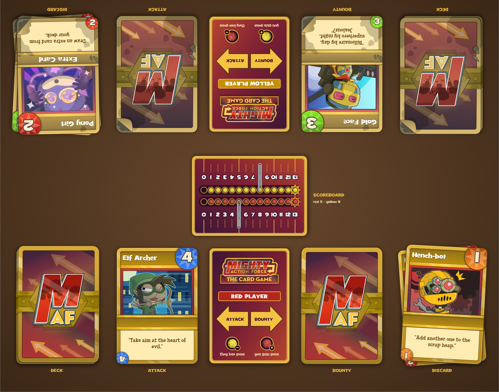

# Mighty Action Force: The Card Game (PnP)

[](https://claude.com/claude-code)

A two-player print-and-play version of the [Mighty Action Force card game][card-game] from [Poptropica][poptropica]'s
[PoptropiCon island][poptropicon]. An unofficial fan project, not affiliated with Poptropica.

[card-game]: https://poptropica.fandom.com/wiki/Mighty_Action_Force_Card_Game
[poptropica]: https://www.poptropica.com/
[poptropicon]: https://poptropica.fandom.com/wiki/PoptropiCon_Island

**[Download the latest release](https://github.com/20akshay00/MightyActionForceTCG-PnP/releases/latest)**: PDFs for A4
and US Letter, plus single-card images for printing services.



## Building

The Poptropica material (art, fonts, card text) isn't in this repository; it's extracted from the game files by the
[maf-extract](https://github.com/20akshay00/maf-extract) submodule. With its requirements in place:

```
git clone --recursive https://github.com/20akshay00/MightyActionForceTCG-PnP.git
python external/maf-extract/extract.py pnp
python -I src/build.py
```

The build needs Chrome (`CHROME` if it isn't on your path) and the logo from the
[Poptropica Wiki](https://poptropica.fandom.com/wiki/Mighty_Action_Force_Card_Game) at
`assets/img/logo_card_game.png`, which isn't in the game files. Output goes to `build/`.

`src/` assembles the pieces (`core/` loads files and drives Chrome, `pieces/` builds the cards, tuck box and booklet,
`output/` lays out sheets and exports), `templates/` holds the CSS and booklet pages, and
[`assets/`](assets/README.md) and [`data/`](data/README.md) are described in their READMEs.

## Custom cards

Add an entry to `data/cards.json` and its `id` to a deck in `data/decks.json`:

```json
{"id": "my_hero", "style": "clean", "name": "My Hero", "value": 5, "badge": "#22c8b8",
 "effect": "steal", "power_name": "Steal A Gem", "description": "Steal one gem from your opponent.",
 "art": "img/my_hero.png"}
```

Art can be any PNG, JPG or SVG under `assets/`, cropped to the picture window. The fields are listed in
[`data/README.md`](data/README.md).

## Credits

The characters, art, card text and rules come from Poptropica's PoptropiCon island and belong to their owners. The
card list and rules were checked against the
[Poptropica Wiki](https://poptropica.fandom.com/wiki/Mighty_Action_Force_Card_Game) and the decompiled game code.
The art is extracted as vectors from the original Flash game, preserved by the
[Flashpoint Archive](https://flashpointarchive.org/); the logo comes from the wiki.

The code was written with [Claude Code](https://claude.com/claude-code); the art is the game's own, assembled from its
original layers. The only change to it is that the value badge is separated from the card frame so it can be
recoloured per value. The turn cards, scoreboard, tuck box, rules booklet, worn-style Omegon and the booklet's
variants are additions, drawn in code around the original art. The text is set in Billy Serif instead of Arial Bold,
values use the game's Grilled Cheese font, and each card has an upside-down value in its bottom-left corner for the
opponent ([original vs. this version](preview/original_vs_print.png)).

## License

Not for sale or commercial use. Poptropica's material isn't licensed by this project; everything else may be shared
and adapted for non-commercial use, no credit needed. See [`LICENSE`](LICENSE).
